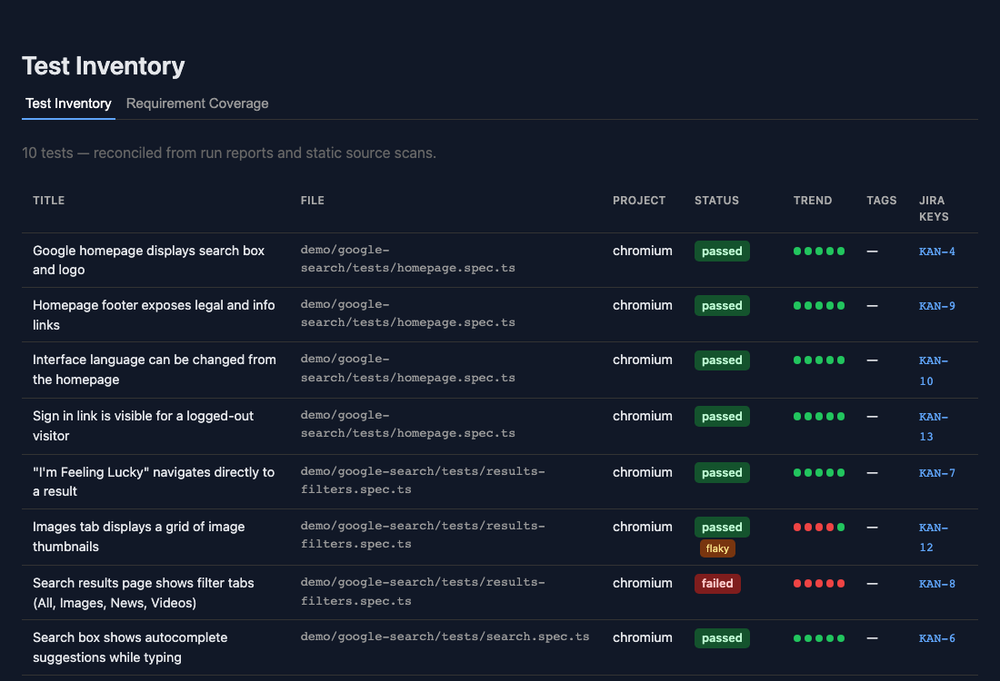
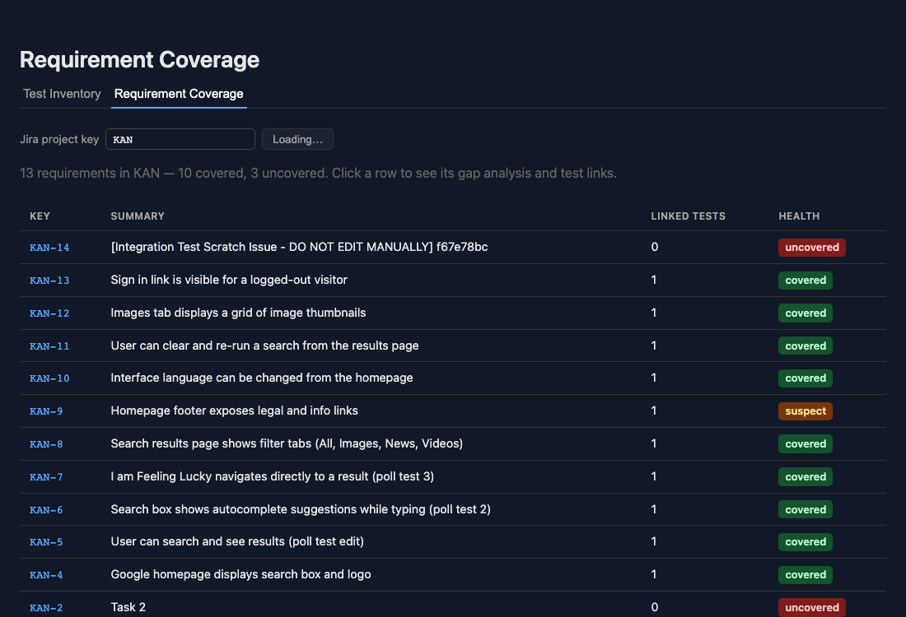
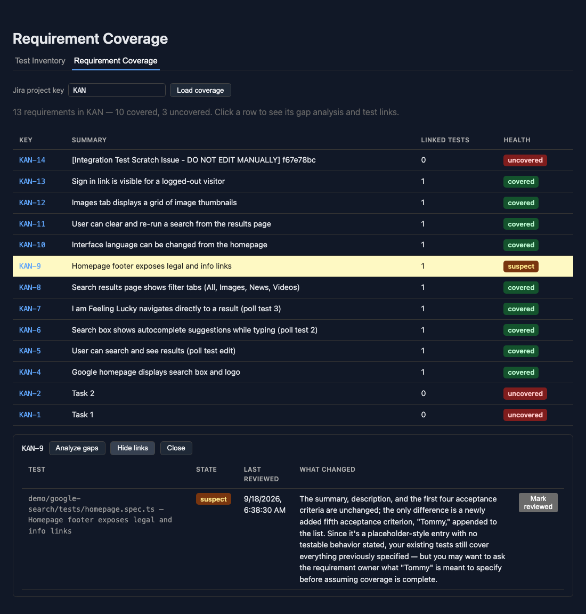

# Playwright Traceability User Guide

_Last updated 2026-11-17._

## Overview

Playwright Traceability answers one question: does this Jira requirement still have a test that actually covers what it asks for? It's built around four ideas:

- **Test Inventory** — every Playwright test the tool knows about, pulled from real run reports and static source scans.
- **Requirement Coverage** — which Jira requirements have at least one linked test, and which don't.
- **Suspect links** — when a linked requirement's content changes in Jira, its test link flips to "Suspect" until a human reviews it. This never clears itself automatically — that's by design, so a real content change can't slip past unnoticed.
- **Gap Analysis** — an AI check of whether a requirement's *individual acceptance criteria* are covered by its linked tests' assertions, not just "some test is linked."

This guide is for QA engineers and team leads who write Playwright tests and track requirements in Jira, and want one dashboard instead of manually cross-checking tickets against test files.

## Two ways to use it

| | **The Jira app** (recommended) | **Self-hosted dashboard** |
| --- | --- | --- |
| What it is | A **Traceability** tab inside each Jira project | A separate web page you run yourself |
| Jira access | The app reads Jira as its own bot user — **you never give it an email or API token** | You give your own backend a Jira email + API token |
| Staying current | Jira tells the app about edits automatically | You set up a webhook or a scheduled poll |
| Setup | Install the app, generate an upload key, add the reporter | Run the backend, connect Jira, push data |

> **Availability:** the Jira app is **not yet on the Atlassian Marketplace** — today it runs as a development install. The self-hosted dashboard works now. The rest of this guide covers both and says which is which.

## Using the Jira app

### Open it

In your Jira project, open the **Traceability** tab. It has three sub-tabs: **Test Inventory**, **Requirement Coverage** and **Settings**. The project is detected automatically — there is nothing to configure to start looking.

> The first load after a quiet spell can take several seconds while the service wakes up. Later loads are quick.

### Connect your CI (Settings tab)

1. Open **Settings** and choose **Generate ingest key**. The key is shown **once** — copy it now. (Generating a new key later replaces the old one immediately.)
2. Store it in your CI as a secret named `TRACEABILITY_INGEST_KEY`. Don't put it in a file you commit.
3. Add the Playwright reporter to your config — see **Getting your tests in** below.

That's the whole setup: no Jira credentials, no webhook, no polling script.

## Getting your tests in

### Option A — the Playwright reporter (recommended)

Add one line to `playwright.config.ts` and set the key; after every run, your results and a scan of your spec files upload automatically:

```ts
export default defineConfig({
  reporter: [["list"], ["playwright-traceability-reporter"]],
});
```

It prints one `[traceability] ...` line and **never changes whether your tests pass or fail** — a missing key, a wrong key or an unreachable server is only a warning. Full details, options and what it does and doesn't send are in [`reporter/README.md`](reporter/README.md). _(The package isn't published to npm yet; until it is, install it from this repository with `npm install ./reporter`.)_

### Option B — the Python script

Run this right after your Playwright suite, typically as a CI step. It also handles `.feature` files and a Jira mapping file, which the reporter does not yet:

```bash
pip install -r requirements.txt  # once per environment; same file the backend uses
export INGEST_API_KEY=...        # your ingest key; set as a CI secret, never in shell history
python -m scripts.push_test_inventory \
  --backend-url https://your-backend.example.com \
  --report report.json \
  --specs-dir tests/ \
  --features-dir features/
```

`--backend-url` is wherever the backend is reachable. Any of `--report`, `--specs-dir`, `--features-dir` can be left out — use whichever apply to your project. Each source adds something the others can't:

| Source | Gives you |
| --- | --- |
| The run itself (the reporter, or `--report` from Playwright's JSON reporter) | Real, resolved test titles — including ones generated in a loop, which no static scan can predict. |
| A scan of `.spec.ts` files (the reporter does this itself; `--specs-dir`) | Tests that never ran (skipped, filtered out), plus `Trace(Jira:KEY)` comments and the assertion text used by Gap Analysis. |
| `--features-dir` (`.feature` files) | BDD/Cucumber scenarios for teams using `playwright-bdd`. Python script only. |

If your team has no Playwright suite yet, every view just shows an empty state — nothing breaks.

## Linking tests to requirements

Put the Jira key anywhere in a test's title, tags, annotations, or in the comment just above it. All of these work:

```ts
// KAN-4
test('Google homepage displays search box and logo', async ({ page }) => { ... });

// Trace(Jira:PROJ-13)
test('should lock account after 5 failed attempts', async ({ page }) => { ... });

test('has a Jira annotation', async () => {
  test.info().annotations.push({ type: 'jira', description: 'PROJ-13' });
});
```

Comments work even though they aren't real Playwright annotations — the scan reads leading comment text directly.

**For teams that don't want Jira keys in test code**, a JSON mapping file links tests from outside (Python script only):

```json
[
  { "file": "auth.spec.ts", "title": "should login", "jira_keys": ["PROJ-101"] }
]
```

```bash
python -m scripts.push_test_inventory --backend-url https://your-backend.example.com \
  --specs-dir tests/ --mapping-file jira-mapping.json
```

`file` should be repo-root-relative and matches by exact `(file, title)`; a mapping entry that never matches any test prints a warning but doesn't fail the push. Mapping keys are added to whatever keys a test already has from a comment — a test can be linked both ways at once.

## Test Inventory tab

One row per test, per project it ran under (a test run on both chromium and firefox gets two rows — they can pass and fail independently).



_The screenshots in this guide show the standalone dashboard; the Jira app shows the same information in Jira's own styling._

| Column | Meaning |
| --- | --- |
| Status | `passed` / `failed` / `never run`, plus a `not in source` badge if the test only exists in a run report (no matching `.spec.ts`/`.feature` file), and a `flaky` badge if it failed at least once before passing on retry. |
| Trend | One mark per recent run, oldest (left) to most recent (right). |
| Tags | Combined from the `{ tag: ... }` option and any run-time tags. |
| Jira Keys | Every requirement this test is linked to — click one to open it in Jira. |

A test only ever run (no source file) or only ever found in source (never run) still shows up as its own row — that's a real signal, not a bug to reconcile away.

## Requirement Coverage tab

The project is loaded for you in the Jira app (type a different project key to look at another one). Each row is one requirement; click a key to open a detail panel below the table with that requirement's actions. The selected key is highlighted.



**Health column** — the requirement's worst linked-test state:

| State | Meaning |
| --- | --- |
| `covered` | At least one linked test, content unchanged since linking. |
| `suspect` | The requirement's content changed in Jira since a test was linked to it — needs human review (see below). |
| `stale` | The linked test no longer exists in the current inventory. |
| `orphaned` | The linked Jira key no longer resolves (deleted, moved, or a typo). |
| `uncovered` | No test is linked at all. |

**In the detail panel:**

- **Analyze gaps** — runs Gap Analysis for the selected requirement (not shown for orphaned keys — there's no live requirement content to check against). If the requirement was analyzed before, its last result is shown as soon as you open it, and the button reads **Re-analyze gaps**.
- **Show N links** — opens a table of every test linked to this requirement, its state, when it was last reviewed, and what changed.
- **Close** — clears the selection.



## Running Gap Analysis

Click **Analyze gaps** in a requirement's detail panel. This is the tool's actual differentiator: instead of just checking "is *a* test linked," it sends the requirement's acceptance criteria plus its linked tests' titles and assertions to Claude, and judges each criterion individually.

Results appear as a list, one line per acceptance criterion:

- **covered** — the linked tests' evidence supports this criterion, with a one-sentence reason why. The reason may also note when a test only *partly* proves a criterion.
- **gap** — nothing in the linked tests' evidence covers it, with a one-sentence reason.

**It runs in the background.** The AI check can take a while, so the app starts it and shows "Analyzing…" while it waits; you can leave and come back, and the result is kept. Each run is a real AI request, so run it on demand per requirement rather than expecting it to run automatically. If the service has no AI key configured, or the AI's response is malformed, you'll see an error message instead of a guessed result — that's intentional, since a wrong "looks fine" verdict here would defeat the point of the feature.

**What is sent to the AI:** for Gap Analysis, only the requirement's acceptance criteria and the titles and `expect(...)` assertion lines of its linked tests. For the "what changed" note (below), the requirement's summary, description and acceptance criteria from before and after the edit. Nothing else — not your test source beyond those assertion lines, not other tickets.

**Acceptance criteria format:** the tool reads acceptance criteria from a heading (e.g. "Acceptance Criteria") followed by a bullet list in the ticket's description. Criteria kept elsewhere (a custom field, plain paragraphs) aren't picked up yet.

## When a link goes Suspect

At link time, the tool hashes a requirement's summary, description, and acceptance criteria. If that requirement's content later changes in Jira, every test linked to it flips to `suspect` — automatically, but it never clears itself automatically.

**In the Jira app, nothing needs setting up for this:** Jira tells the app when an issue is edited, and the link usually flips within a minute. A scheduled hourly check backs this up in case a notification is missed.

To review a suspect link:

1. Open the requirement's detail panel and click **Show N links**.
2. Read the **What Changed** column — a one-to-two-sentence plain-language summary of what actually changed (skipped if no AI key is configured; the suspect flag itself never depends on this).
3. Go confirm the linked test still covers the requirement.
4. Click **Mark reviewed** on that link. This re-snapshots the requirement's current content and clears the suspect state.

This stays human-in-the-loop on purpose: auto-clearing the flag would hide the exact problem it exists to surface.

## Self-hosting: running your own backend

Skip this if you use the Jira app. To run the standalone dashboard against your own backend:

1. Generate an API token at [id.atlassian.com/manage-profile/security/api-tokens](https://id.atlassian.com/manage-profile/security/api-tokens) (log in as the Jira account you want the tool to read as).
2. Install Python dependencies: `pip install -r requirements.txt` (from the repo root — this one file covers the backend, the parsers, and `scripts/push_test_inventory.py`).
3. Start the backend (`uvicorn backend.main:app --reload`) and open its interactive docs at `http://127.0.0.1:8000/docs`.
4. Call `POST /api/jira/connection` with `site_url` (e.g. `https://yourteam.atlassian.net`), `email` (the account that generated the token) and `api_token`.

The backend validates the credentials against the real Jira API before storing them, and returns `401` if they're rejected. You can skip the manual call by setting `JIRA_SITE_URL`, `JIRA_EMAIL` and `JIRA_API_TOKEN` as environment variables before starting the backend — if all three are set and no connection exists yet, it validates and stores them automatically on startup. Then run the dashboard (`cd frontend && npm run dev`) and push data as above, using the key in `INGEST_API_KEY`.

**Staying current without the Jira app:** register a Jira webhook (Settings → System → WebHooks) pointing at the backend, or call `POST /api/jira/poll?project_key=KEY` on a schedule. Neither runs on its own — see `backend/README.md` for the exact setup.

## Troubleshooting

| Symptom | Likely cause |
| --- | --- |
| The first load is slow | The service was idle and is waking up. Wait a few seconds; later loads are quick. |
| Test Inventory is empty | Nothing uploaded yet — add the reporter and run your suite with the key set (look for the `[traceability] uploaded ...` line), or run `scripts/push_test_inventory.py`. |
| The reporter prints `skipped: set TRACEABILITY_INGEST_KEY` | The key isn't in the environment of that run. Set it as a CI secret and expose it as `TRACEABILITY_INGEST_KEY`. |
| The reporter prints `ingest key is missing or wrong` | The key was replaced (generating a new one invalidates the old) or mistyped. Generate a new one in Settings. |
| A test shows `not in source` | It appeared in a run but has no matching source file at that exact `(file, title)`. Often a path mismatch between how the run and the scan were invoked — both should use repo-root-relative paths (the reporter does this for you). Tests generated in a loop will also show this; that's expected. |
| Requirement Coverage says no Jira connection | In the Jira app this shouldn't happen — reload; if it persists, tell us. Self-hosted: complete the one-time setup in "Self-hosting" above. |
| A requirement never goes `suspect` after a real Jira edit | Jira app: wait a minute and reload; edits to fields that aren't summary, description or acceptance criteria don't count. Self-hosted: confirm a webhook is registered, or that the poll is actually being triggered on a schedule. |
| Analyze gaps shows an error instead of results | The service has no AI key set, or the AI's response couldn't be used. This never falls back to a guessed answer. Try again. If it says the analysis was interrupted, just run it again. |
| "Suspect" won't clear | It only clears via **Mark reviewed** on that specific link — by design, nothing clears it automatically. |
